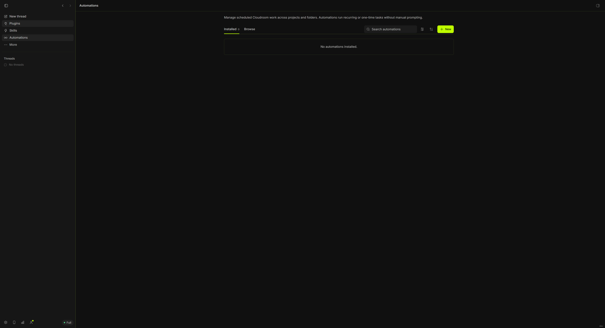

# Cloudroom

**Windows preview:** This fork brings the original desktop interface to native Windows. See [build and launch](gui/docs/windows.md). Windows parity is in progress; the checks and remaining work are documented there.

Start an agent on your Mac. Move it to the cloud mid-task.

[Download](https://www.cloudroom.dev/download) · [Website](https://www.cloudroom.dev) · [Changelog](https://www.cloudroom.dev/changelog) · [Self-host the core](https://github.com/davidondrej/cloudroom-core)

Cloudroom is a desktop app for Claude Code, Codex, and Pi. Your agents run on your Mac or in the cloud, on your own subscriptions.

- **Teleport.** Move a running thread to the cloud and back. Same chat, model, and effort.
- **Local and Cloud, side by side.** Each Cloud thread gets its own sandbox and Git branch.
- **Mac access.** Cloud agents can reach your Mac. You pick Off, Read-only, Ask first, or Full.
- **Multiple Claude accounts.** Switch between them in one click.
- **Computer use.** Every agent can see and control apps, on your Mac and in the cloud.

Local agents are free and need no account. Cloud is invite-only for now, so [join the waitlist](https://www.cloudroom.dev/#waitlist).

Runs on Apple Silicon Macs with macOS 13+. A Linux x64 alpha is on [Releases](https://github.com/davidondrej/cloudroom-gui/releases).

## Source

The app's code is in [gui/](gui/). To build it, see [gui/README.md](gui/README.md). Found a bug? [Open an issue](https://github.com/davidondrej/cloudroom-gui/issues).

Built on [BB](https://github.com/get-bb/bb). Licensed under [Apache 2.0](LICENSE). BB's MIT notice is in [NOTICE](NOTICE).
